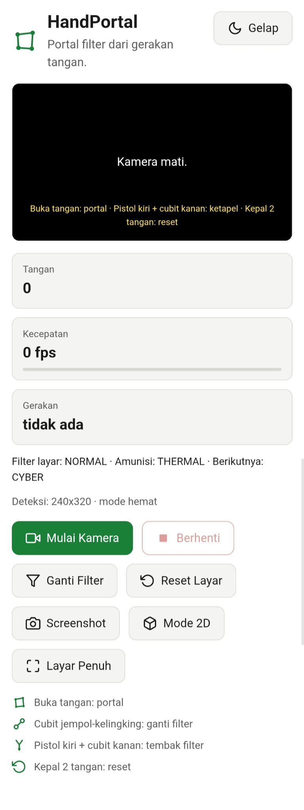

# HandPortal

Portal filter dari gerakan tangan.

[](https://tracking.owebku.site)
[](LICENSE)
[](https://developers.google.com/mediapipe/solutions/vision/hand_landmarker)
[](https://www.python.org)


**Demo live:** https://tracking.owebku.site

HandPortal membuka kamera dan menjalankan MediaPipe Hands langsung di browser. Buka dua tangan, portal segi empat muncul, area di dalamnya kena filter, luar tetap normal. Frame video tidak pernah keluar dari HP.

## Fitur

- Portal 2 tangan dan portal 1 tangan
- 7 filter portal
- Ketapel: tembak filter ke fullscreen
- Mode 3D: dua poligon, dua filter sekaligus
- Screenshot PNG, layar penuh, light/dark
- Target 45 fps, deteksi jalan di browser



## Gerakan

| Gerakan | Hasil |
| --- | --- |
| Buka 2 tangan | Portal segi empat |
| Buka 1 tangan penuh | Portal 1 tangan |
| 1, 2, 3 jari (tahan 1 dtk) | Ganti filter |
| Cubit jempol-kelingking | Ganti filter |
| Pistol kiri + cubit kanan, lepas | Tembak filter ke layar |
| Kepal 2 tangan | Reset layar |

## Filter

| Filter | Cara kerja |
| --- | --- |
| THERMAL | Peta panas dari luminansi |
| CYBER | Neon magenta dan cyan |
| NEGATIVE | Inversi warna |
| DUAL-TONE | Threshold 110, oranye dan ungu |
| PIXELATE | Blok 14px |
| GLITCH | Geser channel R/B + baris noise |
| RAINBOW-WAVE | Sinus + waktu, beranimasi |

## Jalanin lokal

```bash
python3 -m venv venv
venv/bin/pip install -r requirements.txt
venv/bin/python server.py
```

Buka http://127.0.0.1:3122.

Server (Flask) hanya menyajikan file statis dan `GET /api/health`. Tanpa folder `static/`, jalankan server HTTP statis apapun di folder itu, contoh `python3 -m http.server` di `static/`.

## Performa

Kamera mulai di 640x360. Kalau FPS deteksi di bawah 40 selama 2 detik, resolusi turun otomatis ke 320x240 (mode hemat). Angka FPS di status diukur dari frame deteksi per detik. Filter piksel hanya diterapkan pada bounding-box region portal, bukan full frame. Full frame hanya saat filter layar aktif sesudah tembakan ketapel.

## Stack

- MediaPipe Hands klasik (`hands.js` + wasm SIMD, di-vendor lokal di `static/vendor/hands/`, fallback jsdelivr)
- Canvas 2D untuk render dan filter piksel
- Flask untuk menyajikan file statis

## Kredit

Terinspirasi [Retrolens](https://github.com/syahdanfx/Retrolens) (syahdanfx) dan referensi "AR Hand Portal & Filter".

## Lisensi

MIT. Lihat [LICENSE](LICENSE).
